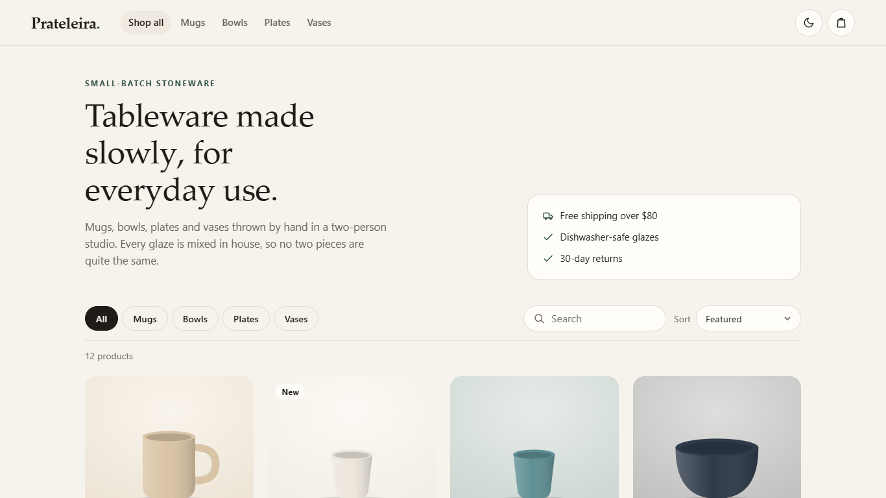
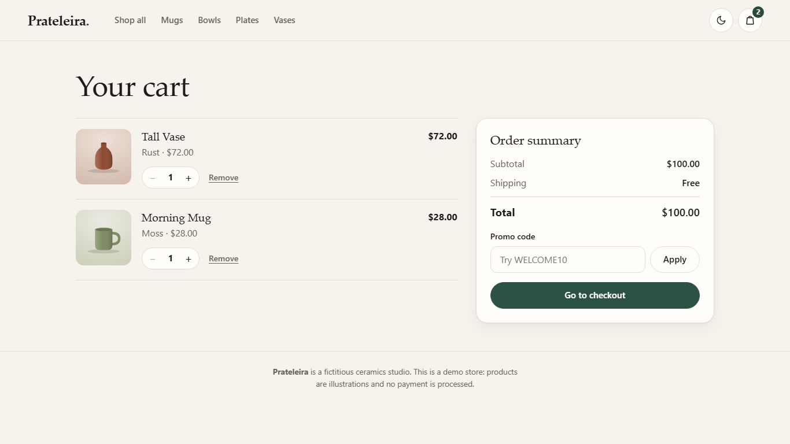
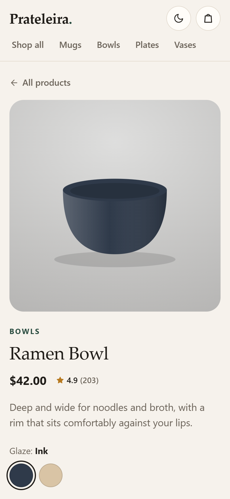

# Prateleira — Handmade Ceramics Store

A storefront for a small (fictitious) ceramics studio: a filterable catalog, product pages with glaze variants, a persistent cart with promo codes and free-shipping progress, and a validated checkout that simulates payment. Built with React, TypeScript and Zustand.

**Live demo:** https://alissonlittig.github.io/prateleira-store/



| Cart | Product page on a 390px phone |
|---|---|
|  |  |

## Features

- **Catalog** with category chips, search and sorting (price, rating). The view state lives in the URL, so filtered pages can be shared.
- **Product page** with glaze swatches (accessible radio group), a quantity stepper and related products.
- **Cart** that persists across reloads: merges identical items, caps quantities, applies promo codes (`WELCOME10`) and shows how much is left for free shipping.
- **Checkout** with field-level validation (email, postal code, card number with the Luhn check, expiry date in the future, CVC). Errors are linked to their inputs and focus moves to the first invalid field. No payment is ever processed; test card `4242 4242 4242 4242`.
- **Order confirmation** page; the cart is cleared once the order is placed.
- **Light and dark themes**, responsive from 390px phones up, with no image files: products are drawn as SVG, so the page stays light and sharp on any screen.

## Stack

| | |
|---|---|
| UI | React 18, TypeScript (strict), hand-written CSS with custom properties |
| State | Zustand with the `persist` middleware (cart, promo code, last order) |
| Routing | React Router 6 (`HashRouter` for GitHub Pages) |
| Build | Vite |
| Tests | Vitest + Testing Library: pricing rules, validation, store actions and the full buy flow |
| Quality | ESLint with `typescript-eslint`, `react-hooks` and `jsx-a11y` |
| CI/CD | GitHub Actions: lint → test → build → deploy to GitHub Pages |

## Project structure

```
src/
  lib/catalog.ts    products, search/sort
  lib/pricing.ts    totals, promo codes, shipping rule, checkout validation (pure functions)
  store.ts          Zustand cart store
  pages/            Shop, ProductPage, Cart, Checkout, Confirmation
  components/       SVG product art, icons, quantity stepper, theme toggle
  test/             Vitest suites
```

## Decisions

- **Money rules are pure functions** (`totals`, `validateCheckout`) tested on their own, including the edge case where a discount drops an order back under the free-shipping threshold.
- **The cart stores ids, not product copies.** Prices always come from the catalog, and a line whose product no longer exists is dropped instead of breaking the page.
- **Zustand over Context** here because the cart is read from many places (header badge, product page, summary) and selectors keep re-renders small.

## Running locally

```bash
npm ci
npm run dev
npm test
npm run lint
npm run build
```

The studio, products and reviews are fictitious. This is a demo store and no orders are sent anywhere.

## License

MIT
